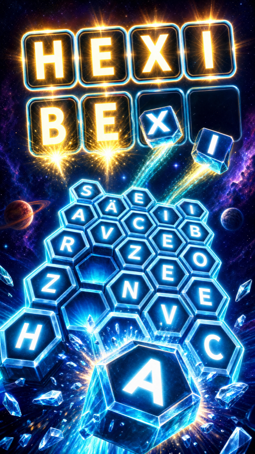
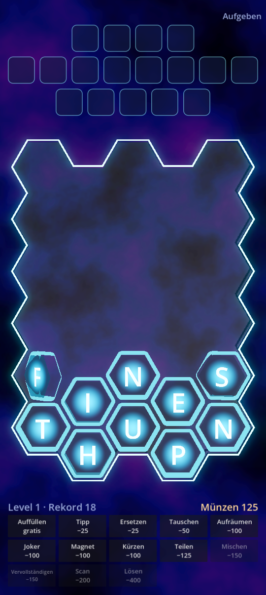

# Hexi Bexi

Ein Wortspiel fürs Handy: Buchstaben in leuchtenden 3D-Kristall-Hexagons füllen das Spielfeld, du wischst Wörter und löst damit Aufträge. Gebaut mit [Godot](https://godotengine.org/).

<p align="center">
  
  &nbsp;&nbsp;
  
</p>

## Worum es geht

Über dem Spielfeld stehen Zeilen mit leeren Blöcken. Jede Zeile wartet auf ein Wort mit genau so vielen Buchstaben. Du verbindest die Buchstaben im Feld mit dem Finger, und passt das Wort, fliegen seine Buchstaben in die Zeile. Sind alle Zeilen gefüllt, ist das Level geschafft.

- **Lauf-Modus:** 20 Levels am Stück, im Stil eines Roguelikes. Gelöste Aufträge bringen Münzen, mit denen du Hilfen kaufst: Tipp, Tauschen, Joker und mehr. Wer nicht weiterkommt, gibt auf und beginnt von vorn. Wer es schafft, bekommt bis zu drei Sterne.
- **Story-Modus:** Kapitel mit Themen wie Tiere, Gemüse oder Früchte. In jedem Kapitel verstecken sich Themenwörter, ein Rätselsatz gibt einen Tipp.
- **Tutorial** beim ersten Start.
- **Offline und ohne Datensammlung:** kein Tracking, keine Werbung, keine Käufe. Das Wörterbuch steckt in der App.

## Wie es entstanden ist

Hexi Bexi ist mein erstes eigenes Spiel. Ich habe es in sechs Tagen zusammen mit der KI Claude gebaut, in rund 100 Iterationen. Ich habe beschrieben, getestet und entschieden, den Code hat die KI geschrieben. Die ganze Geschichte erzähle ich bald in einem Beitrag auf meiner Webseite.

Wie das Spiel funktionieren soll, steht in der Spezifikation unter [`spec/`](spec/README.md). Dort liegen auch die Skizzen und Screenshots aus der Entwicklung.

## Stand

Das Spiel läuft auf Android und ist spielbar: Lauf-Modus mit Hilfen, Story-Modus, Tutorial und Bilanz. Es gibt noch keinen Ton (nur Vibration) und noch keine Veröffentlichung im Play Store.

Noch offen sind unter anderem:

- die Optik von Karten und Knöpfen
- einen angefangenen Lauf speichern
- die Markenprüfung für den Namen
- iOS, das später dazukommen soll

## Selbst ausprobieren

Du brauchst **Godot 4.7** (Standard-Version, kein Spezial-Build).

1. Repo klonen.
2. In Godot den Ordner `hexi-bexi/` als Projekt öffnen.
3. Starten. Das Spiel ist fürs Hochformat gebaut, am besten das Fenster entsprechend schmal ziehen.

Tests laufen mit [GUT](https://github.com/bitwes/Gut):

```bash
tools/run-tests.sh
```

Findet das Skript Godot nicht, gibst du den Pfad mit: `GODOT=/pfad/zu/Godot tools/run-tests.sh`.

## Aufbau des Repos

| Ordner | Inhalt |
|---|---|
| `hexi-bexi/` | Das Godot-Projekt: Spiellogik (`core/`), Szenen, Shader, Daten und Tests |
| `spec/` | Spezifikation: Regeln, Modi, Screens, Optik, Architektur, mit Bildern |
| `tools/` | Hilfswerkzeuge, z. B. zum Bauen des Wörterbuchs (`tools/dictionary/`) und für die Tests |

## Wörterbuch und Lizenzen

Die deutsche Wortliste stammt aus freien Quellen:

| Quelle | Lizenz |
|---|---|
| [Trennmuster-Wortliste](https://repo.or.cz/wortliste.git) (DANTE, Werner Lemberg u. a.) | MIT |
| [Deutscher Wiktionary](https://de.wiktionary.org/), Auszug über [kaikki.org](https://kaikki.org/) | CC BY-SA 3.0 / GFDL |
| [Leipzig Corpora Collection](https://wortschatz.uni-leipzig.de/) (Universität Leipzig), nur für Worthäufigkeiten | CC BY |

Die daraus erzeugte Wortliste (`hexi-bexi/data/languages/de/`) steht wegen des Wiktionary-Anteils unter **CC BY-SA** (Details in [`WORDS-LICENSE.md`](hexi-bexi/data/languages/de/WORDS-LICENSE.md)). Wie sie gebaut wird, steht in [`tools/dictionary/README.md`](tools/dictionary/README.md).

Für alles andere, also Code, Grafiken, Texte und Spezifikation, gilt:

© 2026 Adrian Jetzer. **Alle Rechte vorbehalten.** Du darfst dir alles ansehen und daraus lernen. Kopieren, verändern oder weitergeben ist ohne meine Erlaubnis nicht gestattet.
