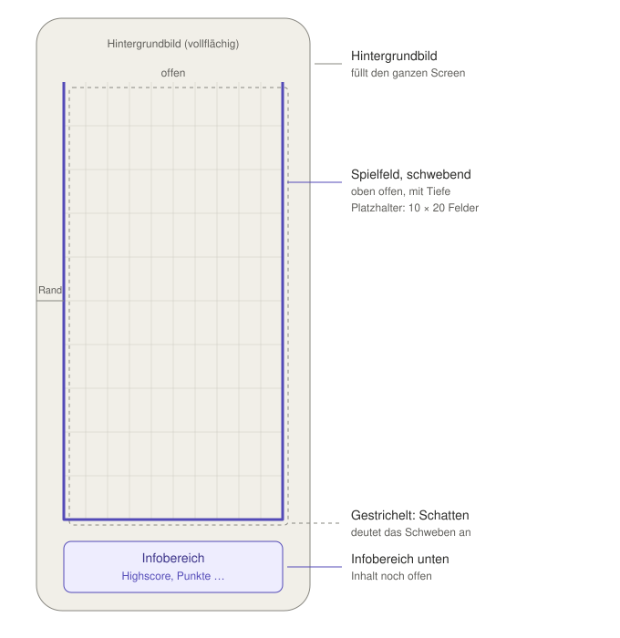
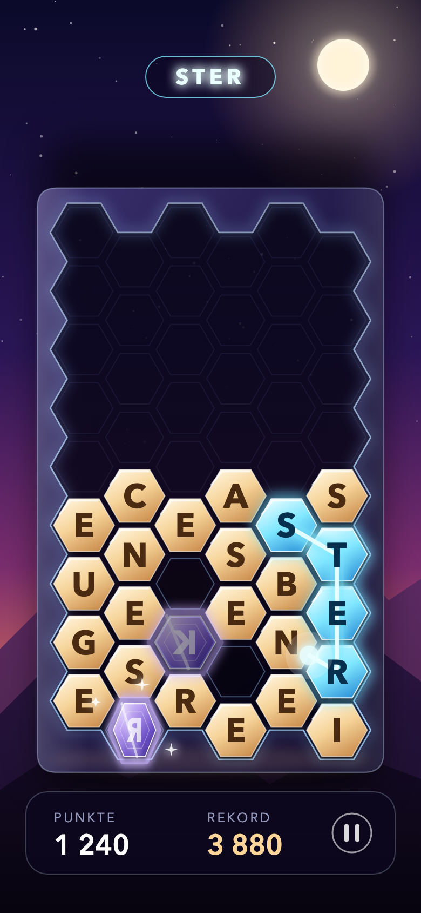

# Screen-Layout (Hauptspiel-Screen)

Status: **Entwurf v3**, Layout und Rastergröße abgestimmt; Optik und Details offen.

> Die Skizze v1 zeigt noch das alte Spielfeld (oben offen, Platzhalter-Raster 10 × 20). Gültig ist der Text unten.

## Mock-Screenshot (v5, gewählte Rastergröße)

Zeigt das Spiel mitten in einer Runde: geschlossenes Spielfeld mit Zickzack-Innenkante, Raster **6 Spalten × 9 Reihen**, leere Plätze als zarte Waben, Löcher nach einem gefundenen Wort, zwei neue Hexagons mit spiegelverkehrter Rückseite (eines blendet ein, eines dreht sich), der Spieler wischt „STER…“.

> **Optik nur Platzhalter**, nicht abgestimmt: Abendhimmel, Milchglas-Rahmen, goldene Hexagons, violette Rückseite, Wort-Blase oben.
>
> **Veraltet im Mock:** Der Pause-Knopf unten rechts entfällt (es gibt keine Pause). Stattdessen gibt es einen kleinen Menü-Knopf, und der Infobereich zeigt mehr (siehe unten).

### Verglichene Rastergrößen

| Mock | Raster | Plätze | Status |
|---|---|---|---|
| [v2](images/ingame-mock-v2.png) | 11 × 17 | 187 | verworfen: zu viele, zu kleine Hexagons |
| [v4](images/ingame-mock-v4.png) | 7 × 11 | 77 | verworfen |
| **[v5](images/ingame-mock-v5.png)** | **6 × 9** | **54** | **gewählt** |
| [v3](images/ingame-mock-v3.png) | 5 × 8 | 40 | verworfen: zu wenige Buchstaben |

## Festgelegt

- **Ausrichtung:** Hochformat.
- **Hintergrund:** ein wunderschönes, bildschirmfüllendes Hintergrundbild.
- **Spielfeld:**
  - Außen ein **Rechteck**, **ringsum geschlossen** (oben nicht mehr offen, da nichts hineinfällt).
  - Die **Innenkante folgt dem Hexagon-Raster im Zickzack** (Variante A): Boden und Seitenwände haben Nischen, in die die Hexagons passgenau sitzen. So entstehen keine Lücken an Wand und Boden.
  - Liegt **über** dem Hintergrund und wirkt schwebend (Tiefe, Schatten, Licht), **nicht flach**.
  - Füllt **nicht** den ganzen Screen: Links, rechts und oben bleibt ein Rand frei, durch den der Hintergrund sichtbar ist.
- **Raster:** Hexagons, unten flach; senkrechte Spalten, jede zweite um ein halbes Feld versetzt (siehe [game-rules.md](game-rules.md)).
  - **Größe: 6 Spalten × 9 Reihen = 54 Plätze** (Mock v5).
  - Durch die gerade Spaltenzahl ist das Feld leicht **asymmetrisch**: Die linke Außenspalte steht ein halbes Feld höher als die rechte.
- **Infobereich unten:** unterhalb des Spielfelds. Zeigt:
  - **Punkte** der Runde
  - **Rekord**
  - **Letztes Wort** mit seinen Punkten (z. B. „STERN +100“)
  - **Level** und **Fortschritt** bis zum nächsten Level (z. B. „Level 2 · noch 80 Punkte“)
  - **Knopf „Neue Buchstaben“** (−20 Punkte)
- **Menü-Knopf:** klein und dezent, zum Beenden der Runde (siehe [screens.md](screens.md)). **Kein Pause-Knopf.**

## Platzhalter (noch nicht entschieden)

- **Ränder:** im Mock ca. 10 % pro Seite.
- **Position des Menü-Knopfs** (z. B. oben links oder im Infobereich).

## Offene Fragen

- Breite der Ränder und Abstand oben (Platz z. B. für Wortanzeige, Level, Pause?).
- Verhältnis Spielfeld zu Infobereich.
- Hintergrundmotiv und Stimmung.
- Material und Lichtwirkung des Spielfelds (z. B. Glas, Holz, Stein, Metall, leuchtende Kanten).
- Rastergröße auf einem **echten Handy** prüfen (Lesbarkeit, Treffsicherheit beim Wischen).

## Verlauf

- **v1:** erste Layout-Skizze (nur Flächen und Proportionen, ohne Optik).
- **v2:** Spielfeld ringsum geschlossen, Innenkante folgt dem Hexagon-Raster (Variante A). Raster 10 × 20 ersetzt durch Hexagon-Raster, Größe offen. Mock-Screenshot v2 ergänzt.
- **v3:** Rastergröße festgelegt: **6 × 9** (Mock v5), nach Vergleich von 11 × 17, 7 × 11 und 5 × 8.
- **v3.1:** Inhalt des Infobereichs festgelegt (Punkte, Rekord, letztes Wort, Tempo-Stufe). Menü-Knopf statt Pause-Knopf.
- **v3.2:** Infobereich: Level mit Fortschritt statt Tempo-Stufe, Knopf „Neue Buchstaben“.
